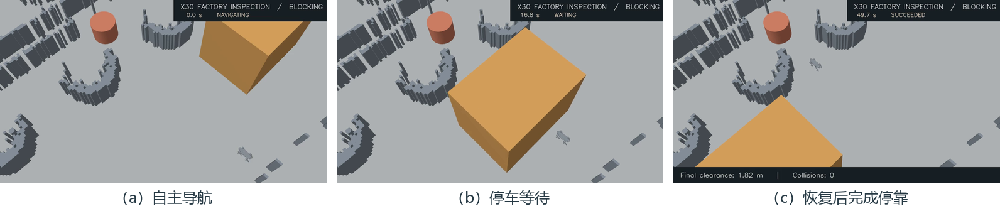
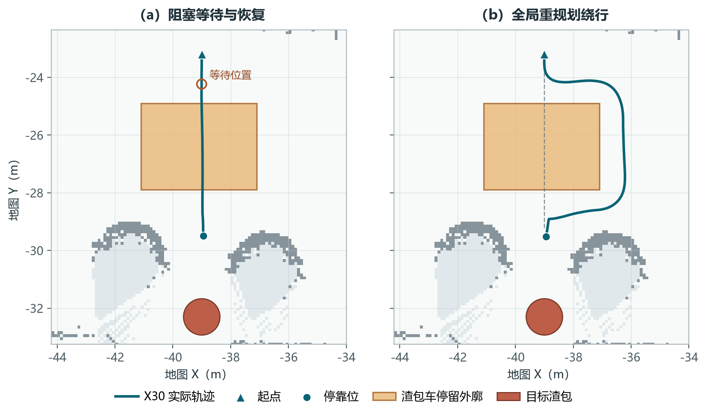

# X30 厂房巡检与动态避障仿真

基于 ROS 2 Humble、Gazebo Fortress 和 Nav2，在厂房栅格地图中完成 X30 自主导航、渣包车避让与渣包停靠。机器狗从指定起点出发，面对横穿或阻塞通道的车辆执行停车等待、恢复导航或全局绕行，最终与目标渣包保持 **1～2 m 的水平外廓净距**。

本仓库实现了地图到碰撞场景的生成、X30 站姿模型定标、外廓净距停靠、动态工况调度、速度保护和实测验收。导航采用 AMCL 定位、NavFn 全局规划与 DWB 局部控制。已归档四项停靠工况和一项雷达断流停车测试，提供轨迹、指标、录像和阻塞工况录包。

[观看阻塞等待与恢复视频](artifacts/final/blocking_verified/inspection.mp4) · [观看全局绕行视频](artifacts/final/detour/inspection.mp4)

## 实现难点与处理

### 地图、外观和碰撞外廓的一致性

厂房输入为 1152 × 715 的 PGM 栅格，每格 0.10 m。地图生成器处理图像行号与地图 Y 轴的转换，以及地图原点的平移和旋转，按占用格生成带碰撞体的厂房障碍。连续占用区间合并为矩形后分块写成网格，离线测试逐格核对生成网格对占用格的覆盖。

X30 原始 URDF 与 STL 经关节变换合成为固定站姿，按 0.70 m 长度等比定标。模型的实际宽度与标称宽度共同确定车身碰撞体，默认平面外廓为 0.70 × 0.40 m。该外廓供物理碰撞、Nav2 与净距计算使用。启动前还检查起点、停靠段和车辆转向及平移过程中的采样外廓，提前发现占用格或未知区域冲突。 [地图读取](src/smelter_gazebo/smelter_gazebo/grid.py) · [场景生成](src/smelter_gazebo/smelter_gazebo/world.py) · [X30 模型生成](src/smelter_description/smelter_description/model.py)

### 按外廓净距完成两阶段停靠

停靠计算把机器人和目标都表示成水平多边形，求两者外廓的最短距离，支持圆形目标以及具有任意偏航角的矩形目标。程序沿指定接近方向二分搜索停车位姿，再向后偏移得到预停靠点。

任务先通过 `NavigateToPose` 到达预停靠点，再将当前位置到停车点的直线路径交给低速 `Dock` 控制器。导航速度上限为 0.33 m/s，停靠速度上限为 0.075 m/s。控制器完成后，还要求净距、朝向和底盘速度满足条件并稳定保持 0.60 s，随后以 Gazebo 真值复核净距和朝向。 [目标解析与净距求解](src/smelter_tasks/smelter_tasks/config.py) · [共享几何计算](src/smelter_gazebo/smelter_gazebo/geometry.py) · [任务状态机](src/smelter_tasks/smelter_tasks/mission.py)

### 动态车辆下的等待、恢复和绕行

渣包车按检查点行驶，使用仿真时间控制入场延迟和停留时长。横穿与阻塞工况保留静态全局路线，由实时激光、局部规划和近距离保护处理车辆。任务节点在前方区域持续检测到阻塞后取消动作，等前方持续清空、动作取消收尾且定位可用后，再提交当前阶段的任务。

`detour` 工况将激光观测加入全局代价地图，使行为树周期规划可以选择另一条路线。车辆的转向和运动依靠差速模型执行，任务事件记录车辆到达、停留和驶离的时刻，可与机器狗轨迹对照。 [车辆调度](src/smelter_tasks/smelter_tasks/cart.py) · [工况配置](src/smelter_tasks/config/cart_route.yaml) · [Nav2 与工况开关](src/smelter_bringup/launch/full_system.launch.py)

### 将扫描时效和近距离保护串入速度链

Nav2 请求速度先经过 `scan_relay`，再交给 Collision Monitor，最后到达差速底盘。扫描超过 0.35 s、速度命令超过 0.25 s 或任务终止时，中继输出零速度。Collision Monitor 根据激光在减速区与停车区内的点数限制速度，底盘控制器另有 0.4 s 的命令超时。

任务还处理启动就绪等待、任务超时和仿真时钟停滞。在运动中注入雷达断流，分别记录请求速度、保护后速度和轮式里程计速度，以核对停车命令和实际制动过程。 [扫描中继与时效检查](src/smelter_tasks/smelter_tasks/scan_relay.py) · [Collision Monitor 配置](src/smelter_navigation/config/nav2.yaml) · [故障注入与 watchdog](src/smelter_tasks/smelter_tasks/mission.py)

### 用仿真真值核对控制结果

导航使用 AMCL、激光和轮式里程计构成的 `map → odom → base_footprint` 变换。实验评分使用 Gazebo 模型位姿，记录实际路径、目标和车辆净距、接触事件、等待时间及横向偏移。车身接触传感器经过主动接触对照试验，确认接触事件能够触发任务中止。

指标输出包含本次解析后的任务配置、逐时刻轨迹和事件表，验收脚本进一步检查各工况应出现的行为。例如阻塞工况需要等待与恢复，绕行工况需要实际横向偏移，断流测试需要注入记录和已确认的停车结果。 [指标采集](src/smelter_tasks/smelter_tasks/metrics.py) · [工况验收](scripts/check_results.py)

## 实测结果

归档运行环境为 Ubuntu 22.04.5 WSL 2、ROS 2 Humble、Gazebo Fortress 6.18.0。默认起点 `(-39.00, -23.20) m`，目标渣包中心 `(-39.00, -32.30) m`，渣包半径 0.63 m。表中用时从首个导航目标发出开始，净距按 Gazebo 真值位姿和两个水平外廓计算。

| 工况 | 仿真用时（s） | 实际路径（m） | 静止等待（s） | 最近车辆净距（m） | 最终目标净距（m） | 朝向误差（rad） | 接触事件 |
| --- | ---: | ---: | ---: | ---: | ---: | ---: | ---: |
| 静态导航 | 33.15 | 6.29 | 0.00 | — | 1.832 | 0.043 | 0 |
| 车辆横穿 | 45.20 | 6.36 | 7.90 | 0.347 | 1.761 | 0.073 | 0 |
| 阻塞等待与恢复 | 49.40 | 6.30 | 16.10 | 0.315 | 1.824 | 0.004 | 0 |
| 全局绕行 | 53.50 | 10.33 | 0.00 | 0.477 | 1.801 | 0.063 | 0 |
| 雷达断流停车 | 2.35 | 0.46 | 0.00 | — | — | — | 0 |

四项停靠工况的最终净距均进入 1～2 m 区间，朝向误差均小于 0.10 rad。断流工况在机器狗运动中触发，1.70 s 注入，2.35 s 确认底盘停稳。接触对照试验单独触发了 1 次碰撞，任务按预期失败并退出。 [静态指标](artifacts/final/static/metrics.json) · [横穿指标](artifacts/final/crossing/metrics.json) · [阻塞指标](artifacts/final/blocking_verified/metrics.json) · [绕行指标](artifacts/final/detour/metrics.json) · [断流指标](artifacts/final/scan_loss/metrics.json) · [接触对照](artifacts/final/contact_sensor/metrics.json)

图中青色曲线为 Gazebo 实测轨迹，橙色框为渣包车在交叉口停留时的外廓。阻塞工况的后半段轨迹在车辆驶离后经过该区域。绕行工况最大横向偏移为 2.79 m，并在车辆驶离前进入停靠阶段。 [阻塞轨迹](artifacts/final/blocking_verified/trajectory.csv) · [绕行轨迹](artifacts/final/detour/trajectory.csv)

阻塞工况在 3.90 s 进入等待，车辆在 7.20 s 开始停留、15.20 s 开始驶离，机器狗在 20.00 s 恢复导航。8 s 的车辆停留对应 16.10 s 的机器狗静止等待，其中包括车辆入场和车身完全移出前方区域的时间。 [阻塞事件记录](artifacts/final/blocking_verified/metrics.json)

该次任务的期望净距为 1.50 m，最终真值为 1.824 m。根据录包临近完成时的 TF 近似重建，定位估计对应净距约为 1.554 m。估计与真值的差异由最终真值验收显式体现，后续改进可进一步量化定位误差对停靠位置的影响。 [任务配置](artifacts/final/blocking_verified/mission.json) · [阻塞录包](artifacts/final/blocking_verified/bag/metadata.yaml)

表中为各工况的一次归档演示，车辆入场位置与停留时序按工况设置。算法对照实验可固定这些条件并重复运行，统计成功率、最小净距和等待时间。当前模型采用固定站姿 X30 与隐藏差速轮，验证已知平面地图中的二维导航和避障行为。后续可在现有感知、控制和验收接口上增加车辆速度估计、短时占用预测及学习策略。

资源目录整理后，从只含发布文件的干净副本重新构建，5 个功能包构建通过。阻塞 Demo 复测用时 50.95 仿真秒，最终净距 1.783 m、朝向误差 0.043 rad、接触事件为 0。 [复测配置](artifacts/final/blocking_recheck/mission.json) · [复测指标](artifacts/final/blocking_recheck/metrics.json) · [复测轨迹](artifacts/final/blocking_recheck/trajectory.csv)

## 运行

使用 Ubuntu 22.04。首次安装依赖时运行安装脚本，已配置好环境时可直接启动 Demo。以下命令在仓库根目录执行。

~~~bash
bash scripts/setup_ubuntu22.sh
bash scripts/run_demo.sh blocking gui:=true record:=true video:=true
~~~

启动脚本会构建五个 ROS 2 功能包，加载环境，生成本次模型和场景，再启动 Gazebo、桥接、Nav2 与任务节点。`gui:=true` 打开 Gazebo 和 RViz，`record:=true` 保存 ROS 2 bag，`video:=true` 保存 Gazebo 俯视视频。任务结束后脚本运行验收并给出 `PASS` 或非零退出码。 [启动入口](scripts/run_demo.sh) · [系统 launch](src/smelter_bringup/launch/full_system.launch.py)

| 工况参数 | 演示内容 |
| --- | --- |
| `static` | 静态导航与低速停靠 |
| `crossing` | 车辆横穿，避让后停靠 |
| `blocking` | 车辆停留 8 s，机器狗等待并恢复 |
| `detour` | 车辆停留 36 s，加入全局实时障碍层并绕行 |
| `scan_loss` | 运动中注入雷达断流，确认底盘停止 |

~~~bash
bash scripts/run_demo.sh static
bash scripts/run_demo.sh crossing
bash scripts/run_demo.sh detour gui:=true
bash scripts/run_demo.sh scan_loss
~~~

每次运行创建独立的 `artifacts/<工况>-<随机后缀>/`，包含 `mission.json`、`metrics.json`、`trajectory.csv`、`launch.log` 和生成的仿真资产。归档结果位于 `artifacts/final/`，已在忽略规则中保留。需要任务结束后继续看场景时，追加 `shutdown_on_result:=false`，查看完按 Ctrl+C 退出。

WSL 下默认采用 `ROS_DOMAIN_ID=53`、`ROS_LOCALHOST_ONLY=1` 和 `RMW_IMPLEMENTATION=rmw_cyclonedds_cpp`，启动终端已有设置优先。第二个 WSL 终端调试话题时使用相同设置。Gazebo 默认通过 EGL 渲染 LiDAR，图形会话可追加 `headless_rendering:=false` 切换渲染方式。 [环境与依赖安装](scripts/setup_ubuntu22.sh)

## 参数与复现

复制默认任务和车路线，在副本中调整起点、目标轮廓、接近方向及车辆检查点，再通过启动参数传入。坐标采用 `map` 坐标系，单位为米和弧度。

~~~bash
cp src/smelter_tasks/config/mission_points.yaml /tmp/x30-mission.yaml
cp src/smelter_tasks/config/cart_route.yaml /tmp/x30-cart.yaml
bash scripts/run_demo.sh blocking \
  mission:=/tmp/x30-mission.yaml cart_route:=/tmp/x30-cart.yaml
~~~

`target.add_model` 为 `true` 时生成渣包碰撞体，并将轮廓同步加入导航地图。目标已存在于输入地图时可设为 `false`，仍需提供用于净距计算的形状与位姿。默认参数下，理想停车中心约为 `(-39.00, -29.82) m`，预停靠中心约为 `(-39.00, -29.22) m`。 [任务参数](src/smelter_tasks/config/mission_points.yaml) · [车辆参数](src/smelter_tasks/config/cart_route.yaml)

在相同 Ubuntu 环境中运行离线测试和归档验收。

~~~bash
PYTHONDONTWRITEBYTECODE=1 python3 -m unittest discover -s tests -v
python3 scripts/check_results.py \
  artifacts/final/{static,crossing,blocking_verified,detour,scan_loss}/metrics.json
~~~
